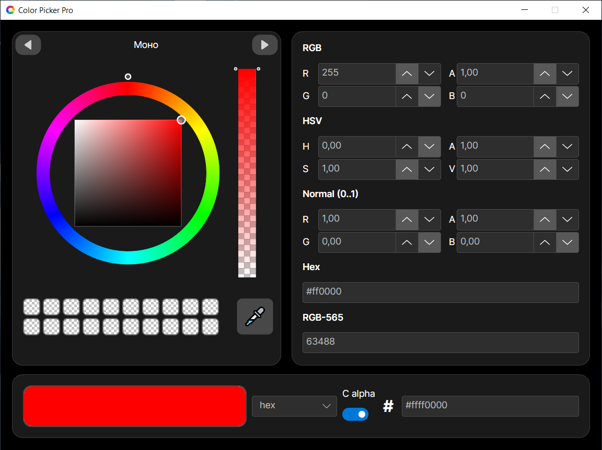
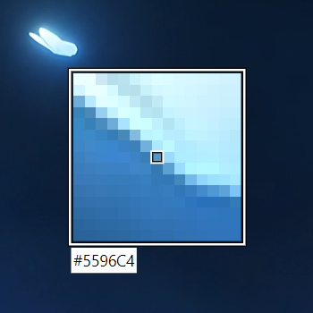

#  Color Picker Pro

**[English](#english) · [Русский](#русский)**

> 🤖 **AI notice / Об использовании ИИ.** This project was developed with the help of AI: a substantial part of the code, the in-app help and this README were written with Claude (Anthropic) under the author's direction.
> Проект разработан с помощью ИИ: значительная часть кода, встроенной справки и этого README написана с Claude (Anthropic) под руководством автора.

---

## English

**Color Picker Pro** is a fast Windows app for picking, analyzing and managing colors.
Made for designers, web developers, game developers and electronics makers.

It lives in the tray, starts instantly and is called with a global hotkey — from the keyboard or a side mouse button.

### New in 3.0: window layout

Tabs can be shown side by side instead of switching between them. **Settings → "Window layout"** shows a mini map of the window:

- Drag tabs with the mouse into other columns, into **"+ new column"** on the left or right, or into **"Hidden"**. The number of columns is not limited.
- The main column — eyedropper, **Values** and the color bar — always stays in place.
- Each column adds ~356 px to the window width; the height doesn't change. Columns added on the left grow the window to the left, so the main column stays where it was. The editor warns if the window won't fit on the screen.
- Presets: **Classic** (all tabs in the main column) and **Designer** (Contrast | Values | History).
- Open tabs are remembered between launches.

### Features

#### 1️⃣ Color wheel and harmonies

Hue wheel and saturation/brightness square (HSV) with transparency (alpha slider).
**The mouse wheel over the ring** changes the hue quickly (1° per step, 10° with Shift).

Color scheme modes: **Mono**, **Complementary**, **Triad**, **Tetrad**, **Analogous**, **Analogous + accent**.

> *Drag the markers on the wheel to change the harmony angle. Click any generated color to make it the main one.*

#### 2️⃣ OKLCH with the mouse

The **"OKLCH"** tab — the perceptually uniform space from CSS Color 4:

- **Hue ring (H)** drawn at the current lightness and chroma: click, drag, mouse wheel or arrow keys.
- **L (lightness) and C (chroma) sliders** with live scales — you see the color before you pick it.
- **Dimmed parts** of the scales are colors the screen (sRGB) can't show; they are mapped to the nearest displayable ones.
- A field for pasting a CSS value: `oklch(62.8% 0.258 29.2)`.

#### 3️⃣ Shade scale 50–950

The **"Shades"** tab builds 11 steps from the current color, like the Tailwind and Material palettes:
50 is almost white, 950 is almost black, the source color lands on the nearest step (outlined).

- Built in OKLCH: even lightness steps, the hue doesn't drift when lightening or darkening.
- Click a step to make it the current color; **"Pin"** lets you go through the steps without rebuilding the scale.
- **Copy to code** in one click: CSS variables (`:root`), Tailwind 4 theme (`@theme`), Tailwind 3 / JS object or a plain list; values in HEX, OKLCH or RGB; the palette name is configurable (`--primary-500`).

#### 4️⃣ Eyedropper

Pick a color from any pixel on any monitor — with the button in the window, from the tray or with a global hotkey.

| Action | Control |
|---|---|
| Pick the color | Left click, Enter or Space |
| Cancel | Right click or Esc |
| Magnifier zoom | mouse wheel, `+` / `-` |
| Move by 1 pixel | arrow keys (10 with Shift) |

The magnifier shows the HEX of the current pixel and the zoom level.

#### 5️⃣ WCAG contrast check and fixer

The **"Contrast"** tab: the current color is the text, the second color is the background.

- Contrast ratio from `1 : 1` to `21 : 1` and a text-on-background preview.
- ✓ / ✗ marks for **AA** and **AAA**: normal text (4.5 / 7), large text (3 / 4.5), icons and UI elements (3).
- **"Current → bg"** and **"⇄ Swap"** buttons: pick the background with the eyedropper first, then the text color.
- **"Fix text" / "Fix background"** find the nearest color that passes the chosen level (AA, AAA or large text):
  only lightness changes, hue and chroma stay. If the level can't be reached, the maximum possible contrast is used.

#### 6️⃣ History and saved colors

- **20 palette slots**: left click — apply, right click — save the current color, middle click — clear.
- **History** — the last 30 colors picked with the eyedropper or copied ("History" tab).

#### 7️⃣ All formats in sync

Change a value in one place and the rest update instantly:
color wheel, RGB, HSV, Normal (0..1), HEX, RGB-565 and OKLCH.

#### 8️⃣ Copy in the format you need

One click on the preview copies the color to the clipboard (or automatically after the eyedropper).

| Format | Example | Used in |
|---|---|---|
| **RGB / RGBA** | `rgb(255, 0, 0)` · `rgba(255, 0, 0, 0.50)` | CSS, Figma, Photoshop |
| **HSV** | `hsv(0, 100%, 100%)` | Photoshop, Unity, OpenCV |
| **Normal (0..1)** | `(1.00, 0.00, 0.00)` | GLSL/HLSL shaders, Unity, Godot, Blender |
| **HEX** | `#ff0000` · with alpha `#ff000080` (RRGGBBAA, CSS) or `#80ff0000` (AARRGGBB) — set in settings | web, Figma, Android, WPF/XAML |
| **RGB-565** | `63488` | Arduino / ESP32 TFT displays |
| **OKLCH** | `oklch(62.8% 0.258 29.2)` | CSS Color 4, Tailwind 4 |

The **ƒ / #** button toggles the wrapper: `rgb(255, 0, 0)` ↔ `255, 0, 0`, `#ff0000` ↔ `ff0000`.
Decimals always use a dot (`0.50`), like in CSS.

> *A detailed cheat sheet on formats and WCAG levels is in the **"Help"** tab right in the app.*

#### 9️⃣ Tray, hotkeys and autostart

- Runs from the tray: closing the window hides it (configurable).
- Global hotkeys for the **eyedropper** and **opening the window** (`Ctrl+Shift+P` and `Ctrl+Shift+O` by default).
- **Mouse buttons** can be assigned too: side Mouse4 ("back") / Mouse5 ("forward"), the middle one with Ctrl/Alt.
- Hotkeys use the system `RegisterHotKey` — no keyboard-wide hook. If a combination is taken by another program, you see it right away in settings and in the tray tooltip; two hotkeys can't be set to the same combination.
- Autostart with Windows: in this mode the window isn't created until it's needed.
- Starting the app again shows the running copy instead of opening a second one.

#### 🔟 Settings

The settings panel slides out from the left and has two tabs.

**General:**

- **General:** autostart with Windows, minimize to tray, **always on top**, **remember the last color** between launches.
- **Eyedropper:** copy after picking, restore the window.
- **Language:** Russian, English or the Windows language (applied after a restart — the "Restart" button).
- **Hotkeys** for the eyedropper and the window (keys or mouse buttons).
- **HEX:** alpha order (`#RRGGBBAA` like in CSS or `#AARRGGBB`) and **uppercase** (`#FF0000`).
- **Transparency background:** light/dark checkerboard or a custom color — picked on the same wheel as in the main window or typed as hex.

**Window layout:** the mini map described [above](#new-in-30-window-layout).

Settings are stored in `%LOCALAPPDATA%\ColorPickerApp\settings.json`.

### Installation

Download the `Color Picker Pro-Setup-<version>.exe` installer from
[Releases](https://github.com/KirillGrushnikov/ColorPickerApp/releases) and run it.
Requires Windows 10 or 11 (x64); .NET doesn't need to be installed.

### Building from source

Requires the [.NET 8 SDK](https://dotnet.microsoft.com/download/dotnet/8.0).

A regular build without AOT: `dotnet publish -c Release -r win-x64 --self-contained true -o ./publish`.

**Help and translation:**

- The "Help" tab text is `Assets/help.ru.md` and `Assets/help.en.md` (simple Markdown: headings, lists, **bold**, `code`, code blocks). The files are embedded into the exe at build time.
- UI strings are in `Localization/Strings.cs`: each entry is a key and a "Russian / English" pair. In XAML a string is used as `{local:Tr key}`, in code as `Loc.T("key")`.

Stack: [Avalonia UI](https://avaloniaui.net/) 11, .NET 8, Win32 API (RegisterHotKey, GDI, low-level mouse hook).

### License

See [LICENSE](LICENSE).

---

## Русский

**Color Picker Pro** — быстрое приложение для Windows для выбора, анализа и управления цветом.
Подходит дизайнерам, веб‑разработчикам, разработчикам игр и электроники.

Живёт в трее, запускается мгновенно и вызывается глобальным хоткеем — с клавиатуры или боковой кнопкой мыши.

### Новое в 3.0: раскладка окна

Вкладки можно открыть рядом, а не переключаться между ними. **Настройки → «Раскладка окна»** — мини-схема окна:

- Вкладки перетаскиваются мышью в другие колонки, в **«+ новая колонка»** слева или справа либо в **«Скрыто»**. Количество колонок не ограничено.
- Основная колонка — пипетка, **«Значения»** и полоса цвета — всегда на месте.
- Каждая колонка добавляет окну ~356 px ширины, высота не меняется. Колонки слева расширяют окно влево — основная колонка остаётся там же, где была. Если окно не помещается на экран, редактор предупредит.
- Пресеты: **«Классический»** (все вкладки в основной колонке) и **«Дизайнер»** (Контраст | Значения | История).
- Открытые вкладки запоминаются между запусками.

### Основные возможности

#### 1️⃣ Цветовой круг и гармонии

Круг тона и квадрат насыщенности/яркости (HSV) с прозрачностью (альфа‑ползунок).
**Колесо мыши над кругом** быстро меняет тон (по 1°, с Shift — по 10°).

Режимы генерации цветовых схем:

- **Моно** – только выбранный цвет.
- **Контраст** – противоположный цвет.
- **Триада** – три цвета, расположенные на круге под углом.
- **Тетрада** – четырёхцветная схема (две комплементарные пары).
- **Аналогия** – соседние цвета на круге (мягкая, гармоничная палитра).
- **Акцент аналогия** – аналогия + контраст.

> *Угол гармонии меняется перетаскиванием маркеров на круге. Любой сгенерированный цвет можно кликнуть — он станет основным.*

#### 2️⃣ OKLCH мышкой

Отдельная вкладка **«OKLCH»** — перцептивно равномерное пространство из CSS Color 4:

- **Круг тона (H)** нарисован при текущих светлоте и хроме: клик, перетаскивание, колесо мыши или стрелки.
- **Ползунки L (светлота) и C (хрома)** с наглядными шкалами — видно, каким станет цвет до того, как вы его выберете.
- **Затемнённые участки** шкал — цвета, которые экран (sRGB) показать не может; такие цвета приводятся к ближайшим отображаемым.
- Поле для вставки значения из CSS: `oklch(62.8% 0.258 29.2)`.

#### 3️⃣ Шкала оттенков 50–950

Вкладка **«Шкала»** строит от текущего цвета 11 ступеней — как палитры Tailwind и Material:
50 — почти белый, 950 — почти чёрный, исходный цвет встаёт на ближайшую ступень (выделен рамкой).

- Шкала строится в OKLCH: шаги ровные по светлоте, тон не «уплывает» при осветлении и затемнении.
- Клик по ступени делает её текущим цветом; **«Закрепить»** — перебирать ступени, не перестраивая шкалу.
- **Копирование в код** одним кликом: CSS‑переменные (`:root`), тема Tailwind 4 (`@theme`),
  объект Tailwind 3 / JS или список; значения — HEX, OKLCH или RGB; имя палитры задаётся (`--primary-500`).

#### 4️⃣ Пипетка (EyeDropper)

Захват цвета с любого пикселя на любом мониторе — кнопкой в окне, из трея или глобальным хоткеем.

| Действие | Управление |
|---|---|
| Выбрать цвет | ЛКМ, Enter или пробел |
| Отмена | ПКМ или Esc |
| Масштаб лупы | колесо мыши, `+` / `-` |
| Сдвиг на 1 пиксель | стрелки (с Shift — на 10) |

Под лупой показываются HEX текущего пикселя и степень увеличения.

#### 5️⃣ Проверка и подбор контраста WCAG

Вкладка **«Контраст»**: текущий цвет — это текст, второй цвет — фон.

- Отношение контраста от `1 : 1` до `21 : 1` и превью текста на фоне.
- Отметки ✓ / ✗ для **AA** и **AAA**: обычный текст (4.5 / 7), крупный текст (3 / 4.5), иконки и элементы интерфейса (3).
- Кнопки **«Текущий → фон»** и **«⇄ Поменять»**: удобно сначала взять пипеткой фон, затем цвет текста.
- **«Подобрать текст» / «Подобрать фон»** — ближайший цвет, проходящий выбранный уровень (AA, AAA или крупный текст):
  меняется только светлота, тон и насыщенность сохраняются. Если уровень недостижим, подставляется максимально возможный контраст.

#### 6️⃣ История и сохранённые цвета

- **20 ячеек палитры**: ЛКМ — применить, ПКМ — сохранить текущий цвет, СКМ — очистить.
- **История** — последние 30 цветов, взятых пипеткой или скопированных (вкладка «История»).

#### 7️⃣ Полная синхронизация форматов

Все способы ввода синхронизированы — измените значение в одном месте, остальные обновятся мгновенно:
цветовой круг, RGB, HSV, Normal (0..1), HEX, RGB‑565 и OKLCH.

#### 8️⃣ Копирование в нужном формате

Цвет копируется в буфер обмена одним кликом по превью (или автоматически после пипетки).

| Формат | Пример | Где используется |
|---|---|---|
| **RGB / RGBA** | `rgb(255, 0, 0)` · `rgba(255, 0, 0, 0.50)` | CSS, Figma, Photoshop |
| **HSV** | `hsv(0, 100%, 100%)` | Photoshop, Unity, OpenCV |
| **Normal (0..1)** | `(1.00, 0.00, 0.00)` | шейдеры GLSL/HLSL, Unity, Godot, Blender |
| **HEX** | `#ff0000` · с альфой `#ff000080` (RRGGBBAA, CSS) или `#80ff0000` (AARRGGBB) — выбирается в настройках | веб, Figma, Android, WPF/XAML |
| **RGB‑565** | `63488` | TFT‑дисплеи Arduino / ESP32 |
| **OKLCH** | `oklch(62.8% 0.258 29.2)` | CSS Color 4, Tailwind 4 |

Кнопка **ƒ / #** включает и выключает обёртку: `rgb(255, 0, 0)` ↔ `255, 0, 0`, `#ff0000` ↔ `ff0000`.
Дробные значения всегда через точку (`0.50`), как в CSS.

> *Подробная шпаргалка по форматам и уровням WCAG — во вкладке **«Справка»** прямо в приложении.*

#### 9️⃣ Трей, горячие клавиши и автозапуск

- Работает из трея: закрытие окна сворачивает его (настраивается).
- Глобальные хоткеи на **пипетку** и **открытие окна** (по умолчанию `Ctrl+Shift+P` и `Ctrl+Shift+O`).
- Можно назначить и **кнопки мыши**: боковые Mouse4 («назад») / Mouse5 («вперёд»), среднюю — с Ctrl/Alt.
- Хоткеи работают через системный `RegisterHotKey` — без перехвата всей клавиатуры. Если комбинация занята
  другой программой, это сразу видно в настройках и в подсказке иконки в трее; при назначении проверяется
  и совпадение двух хоткеев между собой.
- Автозапуск вместе с Windows: в этом режиме окно не создаётся, пока оно не понадобится.
- Повторный запуск не открывает вторую копию, а показывает уже работающую.

#### 🔟 Настройки

Панель настроек выдвигается слева, в ней две вкладки.

**Основные:**

- **Общие:** автозапуск с Windows, сворачивание в трей, **поверх всех окон**, **запоминать последний цвет** между запусками.
- **Пипетка:** автокопирование после выбора, восстановление окна.
- **Язык:** русский, English или как в Windows (применяется после перезапуска — кнопка «Перезапустить»).
- **Горячие клавиши** пипетки и окна (клавиши или кнопки мыши).
- **HEX:** порядок альфы (`#RRGGBBAA` как в CSS или `#AARRGGBB`) и **заглавные буквы** (`#FF0000`).
- **Фон прозрачных областей:** светлая/тёмная шахматка или свой цвет — выбирается на таком же круге, как в главном окне, или вводом hex.

**Раскладка окна:** мини-схема, описанная [выше](#новое-в-30-раскладка-окна).

Настройки хранятся в `%LOCALAPPDATA%\ColorPickerApp\settings.json`.

### Установка

Скачайте установщик `Color Picker Pro-Setup-<версия>.exe` из раздела
[Releases](https://github.com/KirillGrushnikov/ColorPickerApp/releases) и запустите его.
Требуется Windows 10 или 11 (x64); .NET устанавливать не нужно.

### Сборка из исходников

Требуется [.NET 8 SDK](https://dotnet.microsoft.com/download/dotnet/8.0).

Обычная сборка без AOT: `dotnet publish -c Release -r win-x64 --self-contained true -o ./publish`.

**Справка и перевод:**

- Текст вкладки «Справка» — `Assets/help.ru.md` и `Assets/help.en.md` (простой Markdown: заголовки, списки, **жирный**, `код`, блоки кода). Файлы встраиваются в exe при сборке.
- Строки интерфейса — `Localization/Strings.cs`: каждая запись — ключ и пара «русский / английский». В XAML строка подставляется как `{local:Tr ключ}`, в коде — `Loc.T("ключ")`.

Стек: [Avalonia UI](https://avaloniaui.net/) 11, .NET 8, Win32 API (RegisterHotKey, GDI, низкоуровневый хук мыши).

### Лицензия

См. файл [LICENSE](LICENSE).
